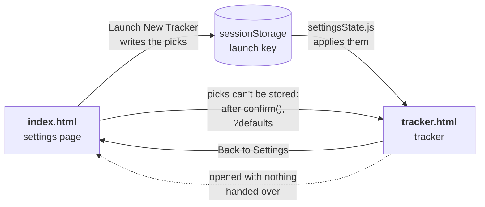
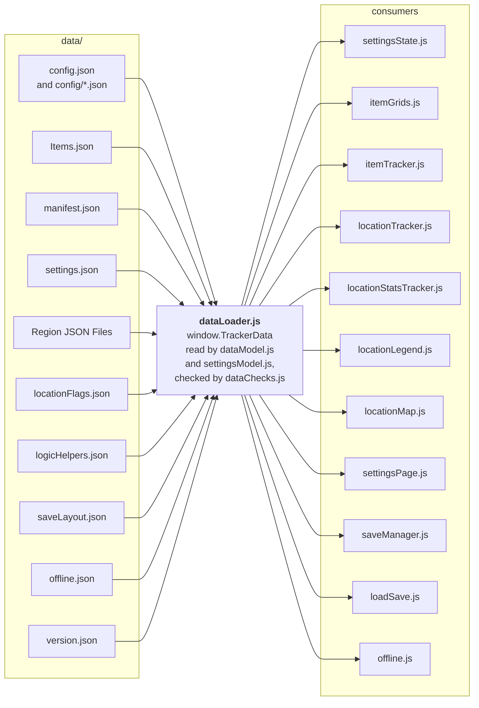
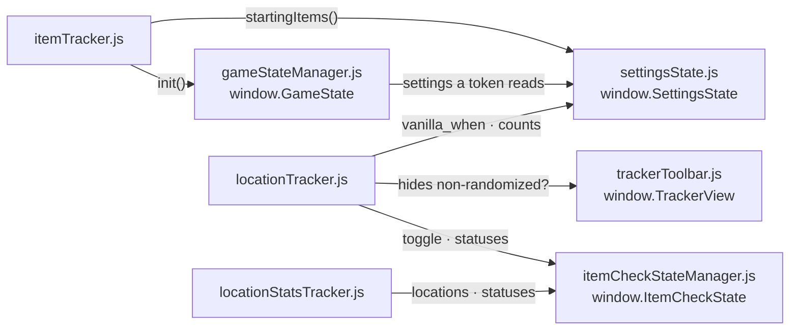
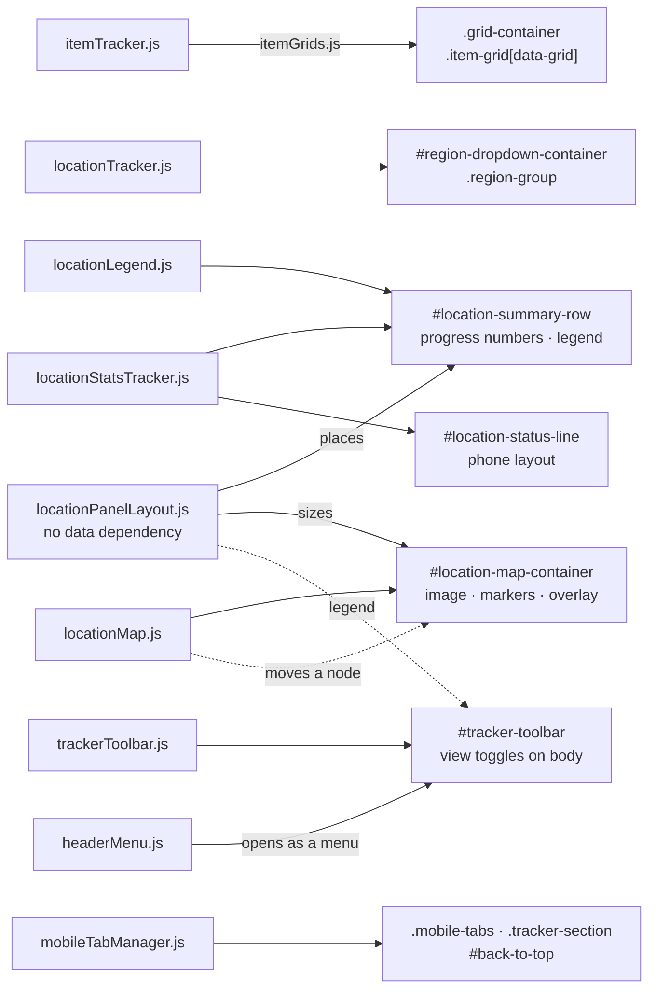
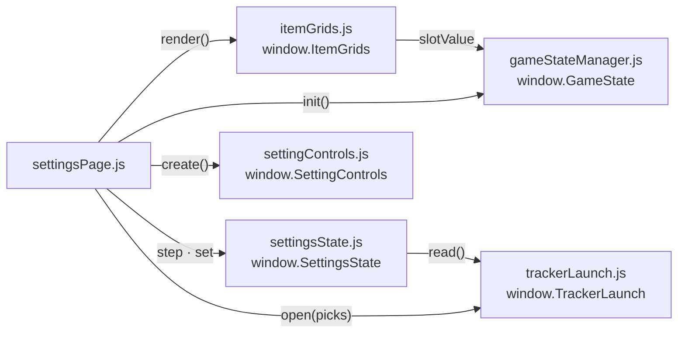
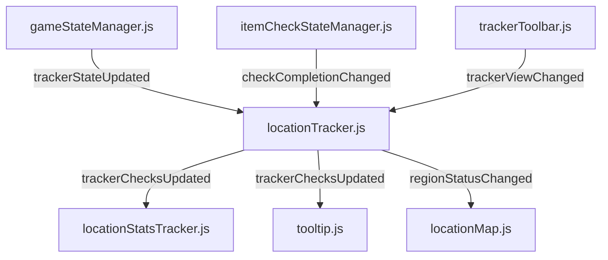
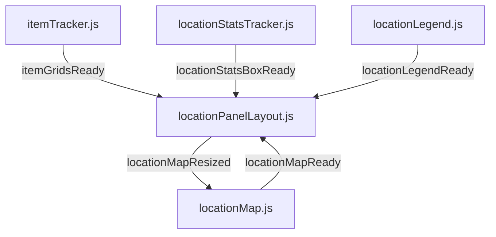
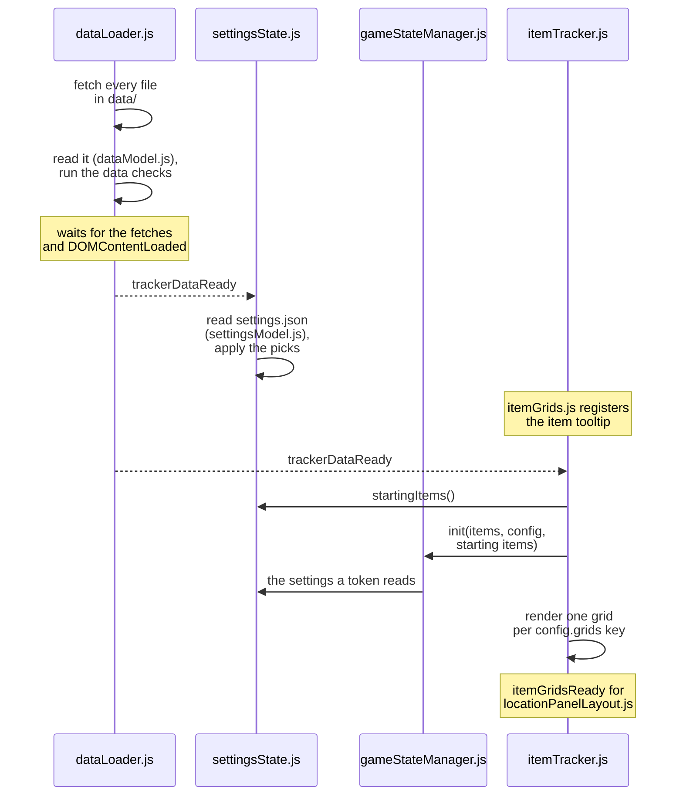
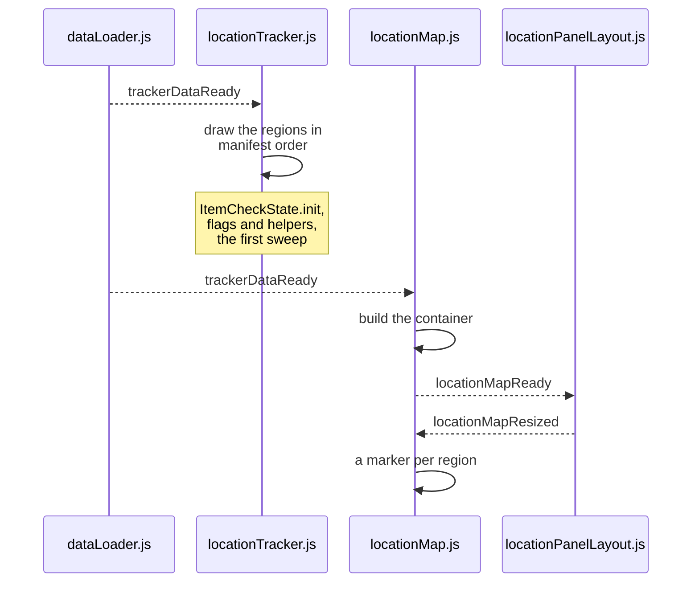

# Architecture

How the tracker's pieces fit together: the design rules, the two pages, every
script and what it owns, the events they talk through, and the order a page loads
in. Each other doc in this folder covers one part in depth (README.md in this
folder lists them).

## Design rules

1. **Plain scripts, loaded in order.** Every file in `js/` is a classic script tag
   in one of the two pages. No `import` or `export`, no bundler: load order is the
   only dependency mechanism, and it matters (*Load order*, below).
2. **Files talk through `window` events, not references.** A file never reaches into
   another's internals; it dispatches a `CustomEvent` on `window`, and whoever cares
   listens. That is what keeps the files independently editable. What files do share
   is one global each: `TrackerData`, `GameState`, `SettingsState`, `ItemCheckState`,
   `TrackerView`, `TrackerLaunch`, `TrackerSave`, `SaveStore`, `SaveCodec`, and the
   helpers `DataModel`, `SettingsModel`, `DataChecks`, `LogicParser`, `Tooltip`,
   `RequirementsView`, `SettingControls`, `ItemGrids`, `StorageKeys`, `PhoneLayout`
   and `FeedbackLinks`.

   Every file is wrapped in an IIFE or defines nothing but its one global, and a new
   one has to be too. A top-level `let` or `const` in a classic script is a global
   *lexical* binding, so two scripts declaring the same name is a `SyntaxError` that
   stops the whole later file before a line of it runs.
3. **Data lives in `data/*.json`, never in JS.** No hardcoded lists of game data at
   the top of a script. A list belongs in the JSON file that owns it (DATA.md).

Anything worth calling from a devtools console goes on `window.TrackerDebug`, which
`gameStateManager.js` creates next to the F1 debug panel and each file fills in:
`evaluateAllRegions()`, `canAccess(logic)`, `resolvedChecks(name)`,
`impliedLayers(name)`, `namedTokens()`, `completedChecks()`, the save helpers and
more.

## Pages

The app is two pages. `index.html` is the settings page, where a visitor lands: pick
the seed's settings, then Launch New Tracker opens `tracker.html`, which runs with
them. The tracker's Back to Settings goes back without asking while the tab is
autosaving the run, since leaving saves it and Load From Autosave brings it back.

**The handoff.** The settings cross over in `sessionStorage`, under the `launch` key,
as the picks that differ from their defaults. `trackerLaunch.js` reads and writes it
on both pages, and `settingsState.js` applies it at load, so the settings page opens
on the last tracker's settings and a reloaded tracker keeps its own. Session storage
belongs to one tab, so two tabs can run two trackers. Picks cross over rather than
locked values, and the tracker works the locks out for itself. The handoff also
carries the run's id and, for a tracker opened from a save, the rest of the save and
which stored copy of the run is this tab's (SAVING.md). The tracker rewrites the
handoff, its own picks included, every time it autosaves, so a reload opens where
the run is, and a page the browser brings back with Back never picks up a later
launch's handoff.

**Opened with nothing handed over**, from a bookmark or a fresh tab, `tracker.html`
goes to the settings page before its body draws: `<html>` carries
`data-requires-launch`, and `trackerLaunch.js` runs in `<head>`. The exception is
`tracker.html?defaults`. When Launch New Tracker can't store the picks, the settings
page warns, asks with `confirm()`, and opens that address, where the tracker starts
on the default settings. Only that write knows whether the picks fit, so the tracker
doesn't test storage itself: a small test value can fit where the picks don't.



Dotted: `trackerLaunch.js` redirecting before the page draws.

### The settings page

```
header
 ├─ logo
 ├─ .mobile-tabs                (phone layout only: the Settings / Starting Items switch)
 ├─ #header-menu-button         (phone layout only: opens the toolbar as a menu)
 ├─ #tracker-toolbar            (Reset to Defaults, Load From Autosave, Load From File, Resume Tracker, Launch New Tracker)
 └─ #header-keep-out            (phone layout only: Resume Tracker, kept out of the menu)
main
 ├─ #home-screen-tip            (iPhone and iPad only, until closed)
 ├─ #save-load-message          (only after loading a save, or failing to)
 ├─ #settings-storage-warning   (only if the browser blocks storage)
 └─ .tracker-layout-wrapper
     ├─ #settings-section > .settings-panel > #settings-list    (every list section, in menu order)
     └─ #starting-section > .starting-items
         ├─ ul.slot-legend      (what the four kinds of slot mean)
         ├─ .grid-container     (the tracker's item grids)
         └─ #starting-extras    (the inventory options, in the phone layout)
footer#app-footer               (#app-version and the feedback links)
#back-to-top                    (phone layout only)
```

How it behaves: SETTINGS.md, *The settings page*.

### The tracker page

```
header
 ├─ logo
 ├─ .mobile-tabs                (phone layout only: the Items / Locations switch)
 ├─ #header-menu-button         (phone layout only: opens the toolbar as a menu)
 ├─ #tracker-toolbar            (Hide Non-Randomized Checks, Show Only Accessible Checks on phones, Export, Back to Settings)
 └─ #location-status-line       (phone layout only: accessible, checked and remaining)
main
 ├─ #home-screen-tip            (iPhone and iPad only, until closed)
 ├─ #autosave-warning           (only if this tab isn't autosaving)
 ├─ #tracker-save-warning       (only if saveLayout.json failed to load)
 ├─ #tracker-map-warning        (only if the map could not be built)
 ├─ #tracker-logic-warning      (only if locationFlags.json or logicHelpers.json failed to load)
 ├─ #tracker-region-warning     (only if a region file failed to load)
 └─ .tracker-layout-wrapper
     ├─ #item-section  > .grid-container > one .item-grid[data-grid] per grid
     └─ #location-section
         ├─ #location-map-container    (built by locationMap.js)
         └─ #region-sidebar > #region-dropdown-container   (the region list)
footer#app-footer               (#app-version and the feedback links)
#back-to-top                    (phone layout only)
```

The item tracker is on the left: four grids of clickable slots (ITEM_GRIDS.md). The
location tracker is on the right: on desktop the game's map, with a marker per
region and an overlay that opens a region's checks; in the phone layout, the regions
as an accordion list (LAYOUT.md).

The order inside `#location-section` is the runtime one: `tracker.html` holds only
`#region-sidebar`, and `locationPanelLayout.js` inserts the map ahead of it. The same
file places `#location-summary-row`, the progress numbers and the legend, in the
header on desktop (LAYOUT.md, *The summary row*).

## Scripts

Both pages load `feedbackLinks.js`, `storageKeys.js`, `phoneLayout.js` and
`trackerLaunch.js` in `<head>`, in that order. Then the settings page loads
`dataModel.js`, `settingsModel.js`, `dataChecks.js`, `dataLoader.js`, `tooltip.js`,
`gameStateManager.js`, `settingsState.js`, `settingControls.js`, `itemGrids.js`,
`saveCodec.js`, `saveStore.js`, `settingsPage.js`, `loadSave.js`, `offline.js`,
`mobileTabManager.js` and `headerMenu.js`. The tracker loads the rest, in the order
`tracker.html` lists them. `offlineWorker.js`, the service worker, sits at the site's
root and runs apart from both pages (OFFLINE.md).

| File | Owns | Globals and DOM |
|---|---|---|
| `feedbackLinks.js` | **First in `<head>`, both pages.** Keeps the page's last warnings and errors, and fills in the footer's Report a bug and Suggest a feature forms as a link is used (*The footer*, below). | `window.FeedbackLinks`, `#app-footer` |
| `storageKeys.js` | **In `<head>`, both pages.** The name of everything kept in browser storage, from the page's `<meta name="tracker-id">` (SAVING.md, *Storage keys*). | `window.StorageKeys` |
| `phoneLayout.js` | **In `<head>`, both pages.** Whether the page is in the phone layout, and a listener for crossing the breakpoint, from the stylesheet's `--mobile-breakpoint` (LAYOUT.md, *Desktop vs mobile*). | `window.PhoneLayout` |
| `trackerLaunch.js` | **In `<head>`, both pages.** Opens the tracker and goes back to the settings page; the two pages' addresses live only here. Reads and writes the handoff (*Pages*, above), and redirects a tracker opened with nothing handed over. | `window.TrackerLaunch` |
| `dataModel.js` | Reads the files in `data/` into what the page uses: the merged config, the usable items and check groups, every region's sub-region tree flattened, the regions that can render, the slot model, the logic tokens, the flags and helpers by name, which checks are one location, and what decides whether a check is reachable: each token's value and what each name in a logic string is worth. Never warns: what it finds wrong goes to `dataChecks.js`. No DOM; a Node module too. | `window.DataModel` |
| `settingsModel.js` | Reads `settings.json`: the settings, sections, grants, locks, `starting_max`, which setting controls which slot, and the clauses (SETTINGS.md). Never warns. No DOM; a Node module too. | `window.SettingsModel` |
| `dataChecks.js` | Every rule the data has to keep, by id, and the one place the page prints what breaks them (DATA.md, *When the data is wrong*). No DOM; a Node module too. | `window.DataChecks` |
| `dataLoader.js` | The only file that fetches `data/`, each file once and never from the browser's cache, so a page never mixes data from either side of a release. Reads it through `dataModel.js`, runs the data checks, then announces `trackerDataReady`. On the settings page its tag carries `data-skip-regions`, which leaves out the region files and the flags and helpers. Draws the load-failure messages. | `window.TrackerData`, `#tracker-load-error`, `#tracker-region-warning`, `#tracker-logic-warning` |
| `logicParser.js` | Parses a logic string into a tree, evaluates it against an inventory, and annotates each part as met, blocking or optional (LOGIC_AND_REGIONS.md, *Logic strings*); `implies(a, b)` decides whether one requirement covers another. No DOM. | `window.LogicParser` |
| `tooltip.js` | Shows, places and hides the tooltip, and pins it on touch; knows nothing about what is in it (TOOLTIPS.md). | `window.Tooltip`, `.tracker-tooltip` |
| `requirementsView.js` | Turns an annotated logic tree into the *Items Required* chips, first rewritten by `simplify()` as the fewest requirements that mean exactly the same (TOOLTIPS.md, *The requirements list*). A Node module too. | `window.RequirementsView` |
| `gameStateManager.js` | The inventory: every slot's value, the floors starting items set, and the logic tokens worked out from them on every change through `DataModel.tokenValue()` (ITEM_GRIDS.md). Builds the F1 debug panel and creates `TrackerDebug`. | `window.GameState`, `window.TrackerDebug` |
| `settingsState.js` | The settings the tracker runs with, as `settingsModel.js` reads them: each value with its locks applied, the picks, the starting items every grant adds up to, and a loaded save's held settings (SETTINGS.md). Applies the handoff's picks at load. | `window.SettingsState` |
| `trackerToolbar.js` | The tracker's toolbar: the two view toggles, each a class on `<body>` (LAYOUT.md, *Hiding checks*), and Back to Settings. Loaded before the trackers, so their first sweep already knows the toggles. | `window.TrackerView`, `#tracker-toolbar` |
| `itemGrids.js` | **Both pages.** Draws one grid per entry in `config/grids.json`, every slot from `GameState`, and registers the item tooltip. | `window.ItemGrids` |
| `itemTracker.js` | The tracker's grids: starts `GameState`, has `itemGrids.js` draw them, and steps a slot on a click or right-click. | `.grid-container` |
| `itemCheckStateManager.js` | Which locations are completed, the record a save reads and writes, and every count of checks on the page (*Contracts and couplings*, below). No DOM. | `window.ItemCheckState` |
| `locationTracker.js` | Draws every region as an accordion, evaluates every check's logic in a sweep, colors the checks and the regions, and announces both. Draws `completed` from `ItemCheckState`, and registers the check tooltip. | `#region-dropdown-container` |
| `locationStatsTracker.js` | The progress numbers (accessible, checked, remaining), counted from `ItemCheckState`, in the summary row and the phone's status line. | `#location-stats-box`, `#location-status-line` |
| `locationLegend.js` | The legend: one row per entry in `config/legend.json`. | `#location-legend-box` |
| `locationPanelLayout.js` | Where the summary row and the map sit, the map's size, and the scale the desktop grids are drawn at (LAYOUT.md). Nothing about tracking. | `#location-summary-row` |
| `locationMap.js` | The desktop map: a marker per region, and the overlay a region's checks open in (LAYOUT.md). | `#location-map-container` |
| `saveCodec.js` | A snapshot of the tracker's state to a save code and back (SAVING.md). No DOM; a Node module too. | `window.SaveCodec` |
| `saveStore.js` | **Both pages.** The saves kept in this browser: the autosave, the previous run and the backup. | `window.SaveStore` |
| `saveManager.js` | **Tracker.** The autosave, and whether this tab owns it. Checks at load that the save layout covers everything there is to save. | `window.TrackerSave`, `#autosave-warning` |
| `exportSave.js` | **Tracker.** The Export dialog. | `#export-dialog` |
| `loadSave.js` | **Settings page.** Load From Autosave, Load From File, the message about a loaded save, and Resume Tracker. | `#save-load-message` |
| `offline.js` | **Both pages.** Registers the offline worker, or removes it when the off switch is set, and shows the Home Screen tip on an iPhone or iPad (OFFLINE.md). | `#home-screen-tip` |
| `mobileTabManager.js` | **Both pages.** The phone layout's switch between the two halves, and the back-to-top button. Announces a switch with `mobileTabChanged`. | `.mobile-tabs`, `#back-to-top` |
| `headerMenu.js` | **Both pages.** The phone layout's header bar: the toolbar as its menu (LAYOUT.md, *The phone layout*). | `#header-menu-button`, `#header-keep-out` |
| `settingControls.js` | **Settings page.** One control per setting class: a slider for a toggle, a select for a dropdown, a number field for a number. | `window.SettingControls` |
| `settingsPage.js` | **Settings page.** The settings panel and the Starting Items half, Reset to Defaults and Launch New Tracker (SETTINGS.md, *The settings page*). | `#settings-list`, `#starting-extras` |

### Who reads what

Nothing reads `data/` but `dataLoader.js`, and every consumer waits for it through
`TrackerData.onReady()`.



On the settings page, `settingsState.js`, `itemGrids.js`, `settingsPage.js`,
`loadSave.js` and `offline.js` wait for the data.

### Who calls whom

On the tracker:



And what each one draws into:



Solid: reads, calls or draws into. Dotted: moves a live element rather than making
one. `locationPanelLayout.js` has no data dependency on purpose: the map's aspect
ratio is handed to it on `locationMapReady`, so it never waits on a fetch.

The settings page, in the same terms:



The settings page's `GameState.init()` is not a tracker starting up: it re-runs on
every change, so the grids show the state the tracker will open with.

## Events

Every event is a `CustomEvent` on `window`.

| Event | Sent by | Heard by | Carries |
|---|---|---|---|
| `trackerDataReady` | `dataLoader.js`, once all of `data/` has loaded **and** the DOM is ready | `settingsState.js` first, so the settings exist before `GameState.init`, then every file that draws from the data | `window.TrackerData` |
| `trackerStateUpdated` | `gameStateManager.js`, on every change to the inventory | `locationTracker.js` (sweeps), the F1 panel, `tooltip.js` (redraws an open tooltip) | `{ items, tokens }` |
| `itemGridsReady` | `itemTracker.js`, once the grids render, **and again** once their images load, if any were still loading | `locationPanelLayout.js` (sizes the map again) | — |
| `regionsRendered` | `locationTracker.js`, once every region is in the page | `locationMap.js` (builds its region lookup) | — |
| `regionStatusChanged` | `locationTracker.js`, when a region's status or counts change | `locationMap.js` (that marker, and an open overlay's titlebar) | `{ regionName, status, accessible, remaining }` |
| `trackerChecksUpdated` | `locationTracker.js`, at the end of every sweep | `locationStatsTracker.js` (recounts), `tooltip.js` (redraws) | — |
| `checkCompletionChanged` | `itemCheckStateManager.js`, when a location is ticked or unticked | `locationTracker.js` (draws `completed` on every row of it, then sweeps) | `{ ids }`, every check id of the location |
| `locationStatsBoxReady` | `locationStatsTracker.js` | `locationPanelLayout.js` (puts it in the summary row) | `{ box }` |
| `locationLegendReady` | `locationLegend.js`, unless the legend has no usable entry | `locationPanelLayout.js` (puts it in the summary row) | `{ box }` |
| `locationMapReady` | `locationMap.js`, once the container exists | `locationPanelLayout.js` (places and sizes it) | `{ mapContainer, aspectRatio }` |
| `locationMapResized` | `locationPanelLayout.js`, after writing a new map size | `locationMap.js` (fits an open overlay again) | `{ mapContainer, width, height }` |
| `trackerViewChanged` | `trackerToolbar.js`, when a view toggle flips | `locationTracker.js` (lets kept rows go, sweeps), `locationMap.js` (fits an open overlay again) | `{ hidesNonRandomized, showsOnlyAccessible }` |
| `mobileTabChanged` | `mobileTabManager.js`, on a switch | `locationTracker.js` (lets kept rows go) | `{ tab }` |
| `regionOverlayClosed` | `locationMap.js`, once the region is back in the list | `locationTracker.js` (lets that region's kept rows go) | `{ regionName }` |
| `settingsChanged` | `settingsState.js`, on every `set` and on `reset` | `settingsPage.js` (redraws every control, count, lock note and slot) | `{ id, value }`, or `{ reset: true }` |

**Don't listen for `trackerDataReady` directly; use `TrackerData.onReady(fn)`.** It
runs the callback at once if the data has already arrived, so a file that registers
late still gets it. Listening for the raw event has a real race.

**Nothing watches the page for changes, and nothing should.** A `MutationObserver`
wide enough to be useful fires on every unrelated write. Worse, the region whose
marker you just clicked has been *moved out* of the region list into the map
overlay, so a watcher on the list can't see the one region most likely to be
changing. `locationTracker.js` causes the changes, so it announces them.

After load, a click on an item or a check sets off a sweep, and the sweep's results
reach the rest of the page:



A tap calls `ItemCheckState.toggle()`, which announces the change back, so a loaded
save is drawn the same way a tap is. `tooltip.js` listens to both state events
because what sits under a still pointer changes when the pointer doesn't move: a
click re-runs the sweep, and an open tooltip would otherwise describe the state
before it.

The layout events run between the drawing files and `locationPanelLayout.js`, which
answers with the map's new size:



`locationMapResized` runs the opposite way to the rest: the layout file telling the
map it has just been resized. Listening for it, rather than racing it on `resize`,
is what makes an overlay's refit correct whichever file registered first, and it is
the only signal when the map changes size with no window resize at all.

Some files also listen to the browser. `locationPanelLayout.js` sizes the map again
on `window.load`, on `resize` and from a `ResizeObserver` on the grids, and
`locationMap.js` fits an open overlay again on `resize`. Crossing the breakpoint is
a `PhoneLayout.onChange`: `locationMap.js` closes an open overlay, handing its region
back to the list; `locationPanelLayout.js` moves the summary row and the legend; the
settings page moves its inventory options; and `tooltip.js` closes a pinned panel
whose button is no longer drawn.

## Load order

`dataLoader.js` starts fetching the moment it is parsed, and fires
`trackerDataReady` once both the fetches and `DOMContentLoaded` are done. Every
consumer registers through `TrackerData.onReady()` while it is parsed, so they run
in `tracker.html` script order and the sequence is the same every time. Before any
of it, the four scripts in `<head>` have run, and `trackerLaunch.js` has either sent
the page to the settings page or let it load.

1. `dataLoader.js` fetches `config.json` and the files it lists, `Items.json`,
   `manifest.json`, `settings.json` and every region file, dropping any region file
   that can't be read. `locationFlags.json`, `logicHelpers.json` and
   `saveLayout.json` load alongside and read as empty, or turn saving off, if they
   fail; `version.json` is fetched on its own, for the footer and the load-error
   report. It reads everything through `dataModel.js`, flattening the sub-region
   trees, and runs every data check, so every warning about the data is printed
   before any consumer runs.
2. The helpers that need no data define their globals: `logicParser.js`,
   `tooltip.js` (which binds its `document` listeners), `requirementsView.js`.
   `gameStateManager.js` builds the empty F1 panel, `settingsState.js` and
   `itemCheckStateManager.js` define theirs, and `trackerToolbar.js` applies both
   saved view toggles, so the first sweep already counts and hides the right checks.
3. *`trackerDataReady` fires.*
4. `settingsState.js` reads the settings and applies the handoff's picks. It is
   first on purpose: nothing may ask for a setting before this, and the inventory's
   tokens read some.
5. `itemGrids.js` registers the item tooltip. `itemTracker.js` calls
   `GameState.init` with the starting items and any handed-over save, has the grids
   drawn, adds its clicks, and sends `itemGridsReady`.
6. `locationTracker.js` registers the check tooltip, draws every region and sends
   `regionsRendered`, hands the regions that drew to `ItemCheckState.init`, indexes
   the location flags and logic helpers, and runs the first sweep. Everything from
   `regionsRendered` on is in a `finally`, each step in its own try/catch, so a
   region file that breaks still leaves the page told about the regions that drew.
7. `locationStatsTracker.js` counts and hands over its numbers, `locationLegend.js`
   its legend, and `locationMap.js` builds the map and its markers.
8. `saveManager.js` checks the save layout, then writes the first autosave, and
   `exportSave.js` enables Export only if saving is on.





Events sent during load can reach nobody: `regionsRendered`, the first
`trackerChecksUpdated` and the first `locationMapResized` go out before their
listeners register, inside the receivers' own `onReady`. Nothing is lost, because
each receiver does the same work in its own start-up.

**`<main>` is hidden until the data has drawn.** Both pages start it with
`awaiting-data`, and `dataLoader.js` takes the class off once every
`trackerDataReady` listener has run, or before it writes the load-failure message,
so a page appears whole rather than filling in. It is `visibility`, not `display`, so
the layout code can still measure, and a CSS animation shows the page after a few
seconds if the scripts never run. The header and the footer wait with it: the
tracker's header takes its width from the scaled layout, and either would jump if
shown early. Meanwhile `.page-loading` shows a loading animation, pure CSS, after a
short delay so a fast load never flashes it.

`locationPanelLayout.js` sits outside the sequence. It has no data of its own and
sizes the map whenever something it measures is ready (LAYOUT.md, *Map sizing and
scale*).

The settings page runs a shorter version: no region files, so none of the rules
about them, then the settings, the grids and the page itself.

## Contracts and couplings

**Region status.** `locationTracker.js` writes a region's status onto its header as
`data-status`, as well as a class, and `locationMap.js` copies that attribute onto
the region's marker without checking it against a list of names. A new status is a
change to `locationTracker.js`'s roll-up and the CSS, and nothing else. A click
recolors one marker, through `regionStatusChanged`, which is only sent when a
region's status or counts actually changed.

**Completed checks.** `ItemCheckState` is the only record of which checks are done;
the `completed` class on a row is drawn from it and never read back. A tap calls
`ItemCheckState.toggle(id)`, which announces every id of that location, and
`locationTracker.js` sets the class on each of their rows, searching the whole page
because a region may be in the map overlay. A loaded save goes through the same
event.

A location is one check, or every check in a `check_group` with it.
`DataModel.locationsOf()` is the one place that works that out: `ItemCheckState`
asks it once at load, and the `vanilla-agreement` data check asks it too. Counting
is `ItemCheckState.count()`, the one rule behind every count on the page: the
progress numbers, a save's progress and each region's header. A region counts a
location once, so two ids of one group in the same region count once, and each
region showing a shared location counts it. The sweep records each check's
accessible and non-randomized status there too, worked out again on every sweep and
never saved.

**Couplings that are not events.** Three, worth knowing before you move anything:

- `locationPanelLayout.js` is the only file that measures the item grids. Keep it
  that way: two files deciding how tall the item column is means two places to fix.
- `locationMap.js` reads `#tracker-debug-panel`'s inline `style.display` to show its
  coordinate finder only while the F1 panel is open. Switching the panel to a class
  would quietly turn the finder off.
- **Calls into another file's global belong inside `onReady`.** The order is only
  guaranteed there. A `Tooltip.register` made at the top of a file throws whenever
  `tooltip.js` loads later, and the rest of that file never runs, with nothing on
  the page to say so.

**The accordion arrow** is only in the CSS (`.region-arrow::after`), switched by an
`expanded` class on the header. JS toggles the class and never writes the glyph,
which is why closing the map overlay removes `expanded`.

## The footer

Both pages end with the version, filled in from `data/version.json`, and two links,
Report a bug and Suggest a feature. Each is a plain link in the page to its GitHub
issue form, so it works when nothing else on the page does. `feedbackLinks.js` runs
first in `<head>`, keeps the last 20 warnings and errors the page prints (passing
each on to the console), and fills the form in through the link's address as the
link is clicked, focused or long-pressed: the version and page, and for a bug the
browser, window size and layout, text size, whether it is installed, the save code
and those messages, trimmed to stay under GitHub's address limit. The values are
named by the forms' field ids in `.github/ISSUE_TEMPLATE`, and the `feedback` test
group checks the two match. GitHub only reads issue forms from the default branch.
