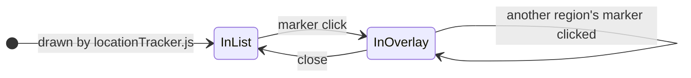

# Layout

How the page is laid out: the split between desktop and the phone layout, the summary
row, the status colors and shapes, hiding checks, the map's markers and size, fitting
a region into the map overlay, and the phone layout's header bar.

## Desktop vs mobile

The breakpoint is `--mobile-breakpoint` in `css/common.css`, 1500px. `phoneLayout.js`
reads it from there, and every script that asks which layout the page is in asks
`PhoneLayout`, so the scripts can never disagree with the CSS. `@media` can't read a
custom property, so every media query still spells the number out; moving it means
changing each of those, the property, and the fallback in `phoneLayout.js` for a
stylesheet that fails to load.

**Every query asks "is this the phone layout?"**: `max-width: 1499px`, and
`not all and (max-width: 1499px)` for a desktop-only block, never `min-width: 1500px`.
With display scaling a window can be between 1499 and 1500 wide, where neither
number claims it; asked as "not the phone layout", every width is exactly one or the
other.

The number comes from the map: below it there isn't room for a readable map beside
the item grids, so the two halves become tabs.

**The region list exists on both.** In the phone layout it is the location view. On
desktop `#region-sidebar` is `display: none` and acts as a storage bin:
`locationMap.js` *moves* a region's element into the map overlay when its marker is
clicked, and back on close, so its listeners and classes survive the trip.

- **Going in**, it remembers the element after the region as its way back, moves the
  region into the overlay, opens it, and fits it (*Fitting a region into the map
  overlay*, below).
- **Coming out**, from the X, the titlebar, a marker or crossing to the phone layout,
  it closes the accordion again, clears the fitting's inline styles, and puts the
  region back **in front of the element it came out from**. Appending it instead is
  invisible on desktop and drops it to the bottom of the phone list the moment the
  window narrows. Then it announces `regionOverlayClosed`.
- Clicking another region's marker closes the current one before opening the next, so
  only one is ever out.

Because a region may be in the overlay:

- Anything about checks queries the whole page (`.region-check-item`), never the
  region list.
- Anything reacting to a change in checks listens for `trackerChecksUpdated` rather
  than watching the list.
- Anything bound to checks is delegated from `document`, as the tooltip is, so
  nothing needs binding again after a move.
- `locationMap.js`'s region lookup only ever adds. Rebuilding it from the list would
  drop the region currently in the overlay and leave its marker gray for good.

## The summary row

`#location-summary-row` holds the progress numbers and the legend.
`locationPanelLayout.js` builds it and fills it as the two pieces announce themselves,
in either order; neither knows the other exists.

On desktop it sits over the map, in the header: the header is two columns, the logo
and a column starting at the map's left edge, with the toolbar at its top and the row
along its bottom. The map is centered in its column and sized in whole pixels, so
`locationPanelLayout.js` measures where it actually starts and hands that to the CSS
as `--summary-inset`. The numbers sit left and the legend right, and on a narrow
window the legend wraps under the numbers. Larger text wraps both further and the
header grows; the map keeps its size and the page moves down. **Keep the toolbar and
the row no taller than the logo at the default text size**, or the page scrolls: the
scale counts the header as its logo (*Scale*, below).

In the phone layout the row is hidden: its numbers are the header's status line, and
the legend moves into the header's menu.

## Status colors and shapes

A check is reachable, out of reach, non-randomized (and reachable), or completed. A
region rolls its checks up: yellow when it has something out of reach beside anything
reachable, green when anything reachable left in it is randomized, purple only when
everything reachable left is non-randomized, and gray with nothing left.

**Each status is a color and a shape, paired once** in `common.css`. Each status class
sets `--status-color` and `--status-shape`, and region headers, check rows, markers
and the legend read those and nothing else, so no surface can disagree with the
legend. An element with no status class draws no status.

| Status | Color | Shape |
|---|---|---|
| `inaccessible` | red | triangle |
| `partialCompletion` | yellow | diamond |
| `fullClear` / `accessible` | green | circle |
| `vanilla` | purple | square |
| `completed` | pale gray | circle |

The shape carries the meaning on its own because red against green is the most common
color blindness, and exactly the distinction the tracker leans on. **Completed shares
the circle with accessible, so lightness separates them**: keep the gray pale. The
`completed` pairing comes last, so a check both completed and reachable shows as
completed.

**Regions count what's left in them**: `Region Name (accessible/remaining)`, how many
checks you could do now out of how many aren't ticked off. `locationTracker.js` puts
the pair on the header as `data-counts`, the first number as `data-accessible`, and
the status as `data-status`. `locationMap.js` reads those back rather than counting
again, so a marker and the overlay's titlebar can't disagree with the header. A marker
shows its count exactly when `data-accessible` is above zero, which is the yellow,
green and purple ones, without naming a status.

## Hiding checks

Two toolbar toggles take checks out of view. `trackerToolbar.js` keeps each as a class
on `<body>`, read through `TrackerView.hidesNonRandomized()` and
`TrackerView.showsOnlyAccessible()`, and a flip announces `trackerViewChanged`. A save
carries both; each is also kept in `localStorage`, which a new tracker starts from.

**Hide Non-Randomized Checks** takes those checks out as if the regions didn't have
them. CSS hides the rows and the legend's *Not Randomized* row; the region roll-up and
the progress numbers skip them, so a region with nothing else reads `(0/0)` and gray.
A flip sets off a sweep, which carries the new counts everywhere through the events
they already hear, and an open overlay is fitted again.

**Show Only Accessible Checks** belongs to the phone layout: its button and its CSS
are under the breakpoint, so a window widened past it shows everything again. It only
hides, never counts. CSS hides out-of-reach and completed checks, the legend's matching
rows, and every region marked `nothing-accessible`, which `locationTracker.js` sets
when the region's accessible count is 0.

**A tap never hides what it just changed.** Completing a check in an open region marks
it, its region and every other row of that location in an open region `keep-shown`,
which the hiding rules skip, so a mistaken tap can be undone where it happened and the
list doesn't jump under the finger. `locationTracker.js` lets the marks go when that
region's header is clicked, on a tab switch, on a toggle flip, and when the map
overlay closes the region. Marks are only made in the phone layout, since the desktop
overlay holds its region open and would never let one go.

## Markers

A marker's shape is drawn by its pseudo-elements, an outline behind and the status
color inset in front, rather than by the button, because `clip-path` would clip the
count along with the shape. A slanted edge shows less outline than a straight one, and
a two-digit count has less room on a tapering shape, so those shapes set a wider
`--status-outline` and a smaller `--status-wide-ratio` beside their pairing in
`common.css`, rather than the map's CSS naming statuses.

**Everything about a marker is a share of the map's width**, so markers grow with the
map. The marker is 3.2% of it, with a floor in pixels, larger once it carries a count.
3.2% is the limit: the closest pair of markers is not much further apart than that,
and a bigger marker would overlap its neighbor at rest. A full square's corners and a
full triangle's base reach further out than a circle, so on a marker those two shapes
are drawn smaller than their box. Hovering grows a marker in front of its neighbors,
which may overlap them while it does.

Keeping the count centered is a stack of rendering traps, each explained beside its
rule in `locationMap.css`. The count is dark with a light halo, which reads on every
fill that carries one; that is why the purple is a light one.

The hover tooltip is `tooltip.js`, registered by `locationMap.js`: the region's name
and its live count. Clicking a marker closes it, since the overlay opens under the
pointer.

## Map sizing and scale

Desktop only: `locationPanelLayout.js`'s `syncPanelHeight()`. The grids are scaled up
on windows with room, and the map is sized to the grids' height, so the two end
together.

### Scale

`--ui-scale` (1 or more) multiplies every size that belongs to the grids in
`itemGrids.css`. It is the largest value at which the grids and a full-height map fit
side by side without the page scrolling, across the window's width and in the height
left under the header and above the footer, and it never goes below 1: a window
narrower than the layout keeps the grids at their base size and narrows the map.

- **From the window, not the page.** Not everything in the grids scales (the slot
  borders stay one pixel), so the grids' size is measured at scale 1 and at 2, inside
  one script so neither is painted. Dividing the current size by the current scale
  instead would settle differently depending on the size the window was resized from.
- **The header counts as its logo.** The toolbar and the summary row grow with the text
  size and wrap with the header's width, which the scale sets. Measuring them would feed
  the scale back into itself, so large text pushes the page down instead of shrinking
  the map.
- **Sized for a design height, not the data's.** `--grid-design-rows` in
  `itemGrids.css` is the grid column's height in slot rows that the layout is drawn
  for. Data with fewer rows is scaled, and its map sized, as if the column were that
  tall, so its slots stay the same size and the space under the grids stays empty;
  without this, fewer slots would mean bigger ones beside a smaller map. More rows
  than that shrink to fit as usual. The missing rows are counted from where the
  slots sit, and each is what a row adds to a grid's own height.
- **`--layout-max-width`** is set to the width the scaled layout takes, so the header
  and `main` line up and stay centered on a very wide window. It isn't known until the
  grids are drawn, which is one reason the header waits with `<main>` at load.

### The map

The map takes the grids' rendered height and the location column's width, and fits a
box of the map image's aspect ratio inside them, setting **both** dimensions from JS.
CSS `aspect-ratio` doesn't resolve to the exact ratio at every width, and a box even
slightly off drifts every marker placed by percentage. If either measurement looks too
small to be real (`MIN_SANE_PX`), as it does mid-load or while the page isn't painting,
it gives up rather than lock in a tiny map.

**It runs from several directions**, because it can give up: the ready events,
`window.load`, `resize`, and a `ResizeObserver` on the grids and the summary row.
`window.load` isn't the backstop it looks like: on a warm cache it fires before the
data is ready, while the grids are empty. And the grids existing isn't the grids being
their final size: until the slot images load they measure a fraction of their height,
plausibly enough to pass `MIN_SANE_PX`. So `itemTracker.js` sends `itemGridsReady`
again once its images are in (ITEM_GRIDS.md, *Sizing*).

### `requestAnimationFrame` can stop

`scheduleHeightSync()` here, `scheduleUpdate()` in `locationStatsTracker.js` and
`scheduleRefit()` in `locationMap.js` each pair `requestAnimationFrame` with a
`setTimeout`. **A window the browser isn't painting stops running frame callbacks, and
`ResizeObserver` stops with them.** A tracker behind an emulator window is the normal
case, not an edge case, and without the timeout its numbers silently stop moving.
Don't feature-detect it: `document.hidden` answers a different question. The same is
why back to top scrolls instantly rather than with `behavior: 'smooth'`, which runs on
the same frames and would do nothing in a covered window.

## Fitting a region into the map overlay

Desktop only: `locationMap.js`'s `fitOverlayContent()`. The overlay shows every check
in a region at once, in a box as wide as the map and about as short: wide and flat, the
opposite of what a list wants.

**How it lays out.** CSS grid, with the column count set from JS. Columns are equal
width and span the whole box, and fill runs down each column before moving right, so a
region's rooms stay grouped the way its file lists them. Not a flex column wrap: flex
sizes each column to its own widest item and packs them left, leaving about a third of
the box empty.

**Where it hangs from**: the top of the location column, so it covers at least the
column when the map is shorter than the grids.

**How tall it may get**: down from the top of the column to a margin above the footer
or the window's bottom, whichever is higher, or the column's own height if that is
larger. The window guarantees the overlay never makes the page scroll (`clientHeight`,
which is what `scrollHeight` is compared against). The footer keeps the version and
the feedback links uncovered; on desktop it is pinned to the window's bottom when the
page is shorter than the window, so stopping above it costs only the footer's height.
**Don't add the item grids' bottom edge as a further ceiling**: it looks like what keeps
the scrollbar away and isn't, and only costs text size.

**Document coordinates, not the viewport's.** Read off `getBoundingClientRect()` alone,
the budget would grow as you scroll, so the same region would open at a different text
size depending on where the page was. Nothing re-fits on scroll either, which would
resize the text under the reader. A measurement that looks wrong falls back to the
height the overlay has to cover anyway.

**How the text is sized.** `config/map.json`'s `map_overlay.text_sizes`, largest
first: the fit walks down the ladder and stops at the first size that fits, so only
the largest regions on a short window shrink at all. The ladder was made for a map
`base_map_width` wide; on a wider one `--overlay-scale` multiplies the text, padding,
gaps and titlebar. A label too long for its column wraps, as a last resort; while
measuring, `nowrap` is forced back on through a CSS variable, because a wrappable label
reports a much narrower width and would throw the column count off.

**It draws its own border**, sitting just outside the map so its border lands on the
map's: the overlay can grow taller than the map, whose border stops at the image. That
is also why the map container has no `overflow: hidden`.

**It fits again** on `locationMapResized` (the map changed size, even with no window
resize), on `resize` (a height-only resize moves the budget but not the map), and on
`trackerViewChanged` (the region gained or lost rows). Triggers that coincide collapse
into one fit.

## The phone layout

Everything below the breakpoint: a bar frozen at the top, and whichever half its
switch shows. It covers wide windows as well as phones, so it has to use the width.

**Both halves flow into columns**, and the browser picks how many: the grids with
`auto-fit` (never more than two across), an open region's checks with CSS columns.

**The header is the bar, `position: sticky`.** It holds the logo, the two-part switch,
the ≡ menu button and, on the tracker, the status line with the progress numbers. It
needs its own opaque background and to sit above the region headers, and above Back
to top, which the open menu reaches on a phone held sideways. Sticky fails silently if
an ancestor ever gets an `overflow` other than `visible`.

**The toolbar is the bar's menu.** The same buttons serve both layouts with the same
handlers; `headerMenu.js` only opens and closes it. A view toggle leaves it open, so its
new state shows; any other button closes it, as do a tap outside and Esc. On the
tracker the legend moves into the menu. **A button marked `data-menu-keep-out` stays
out of the menu**, under the bar in `#header-keep-out`: Resume Tracker, the next step
with a save loaded.

**The bar lets go when it grows.** Taller than a quarter of the window, as at the
largest text sizes, it takes `bar-loose` and scrolls away with the page. Opening the
menu scrolls it into view.

**Anything switched on is `--active-green`**: the active half of the switch and a
pressed toggle.

**Each half remembers its scroll position**, in memory only, since it is where you
were looking, not part of the run. Back to top appears once the page is scrolled half
a screen, and the footer keeps clear of it.

**The page runs under the notch and home bar** (`viewport-fit=cover` in each page's
viewport tag), which is why `body` pads all four sides by the safe-area insets and the
bar pads its top.

Grid traps that only apply here:

- **The digit size is relative to the slot** (`80cqw`), not the viewport, so it follows
  the slot when the grids sit two across.
- **Container query units stay inside the phone media query.** `container-type` on
  `.item-slot` stops the slots feeding `.grid-container`'s `max-content` tracks on
  desktop, and the item panel collapses. Desktop keeps a pixel size times
  `--ui-scale`.
- **`.item-grid` is `border-box` here and `content-box` on desktop, on purpose.** Here
  the tracks are sized from the container, so `content-box` would paint wider than the
  track and scroll sideways; on desktop the `max-content` tracks already match what the
  grid paints, and `border-box` would only shrink every slot.
