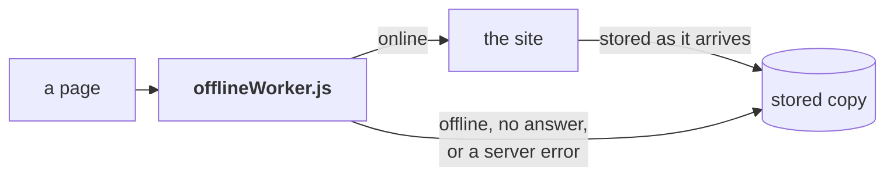

# Offline

The tracker works with no connection once it has been opened online.
`offlineWorker.js`, a service worker at the site's root so it covers both pages,
keeps a copy of every file and answers from it when the site can't. `offline.js`
registers it on both pages.

## Online, the site answers first

Every request goes to the site rather than the browser's cache, and the answer is
stored. A host can let the browser keep a file for minutes after a release, which
could hand a page old scripts beside new data, so a player online always gets the
latest files, and there is no "update available" step. A copy that answered first
would serve stale files until the next release. A running page is never changed
under the player, since files are only fetched as a page loads. A file that can't be
stored, with storage full, still reaches the page.

One cache the worker can't skip: Chromium can reuse a script from memory when a tab
reloads or moves between the pages, and that request never reaches the worker. So
the published site stamps every script and stylesheet address with the version
(`js/foo.js?v=1.2.3`), written by `scripts/release/buildSite.py` into the built copy
only, and after a release the pages ask for addresses nothing has kept. The worker
stores each file under its address without the stamp, so a release replaces a file's
copy rather than adding a second, and finds it again the same way. As it takes over,
after storing the fresh copies, a new worker deletes any stored entry whose address
has a query, such as one an older worker kept under `tracker.html?defaults`: a lookup
that ignores the query returns the oldest entry, so it would answer ahead of the
fresh copy.

## Offline, the stored copy answers

With no connection a request fails at once and the copy answers. A connection that
neither fails nor answers gets a few seconds first; the site's late reply still
updates the copy. A server error (5xx) is the site failing rather than the file
changing, so the copy answers that too. A 404 goes through: that file is gone.

## The copy is the whole site

The first visit stores every file in `data/offline.json`, so a page never opened
online still opens offline. At most once an hour while a page is open online, the
worker checks every file again in the background; an unchanged one costs a short
reply. A file missing from the list is stored the first time a page uses it, so a
stale list costs completeness, not correctness. `scripts/data/updateOfflineFiles.py`
writes the list from the pages, the manifest and everything under `css/`, `js/`,
`data/` and `images/`; a test fails when it is out of date.

The worker names its stored copy after the site's address, not the version. It is
network first, so a release is picked up on the next online visit.

## The off switch

`"enabled": false` in `data/offline.json` turns it off. Every page reads that file
fresh from the site, and on seeing it tells the worker serving it to stop, then
removes every registration and the stored copy. Told to stop, the worker passes
requests straight to the site and stores nothing; otherwise the pages it still serves
would store the copy again as it was deleted. The worker also stops if it reads the
flag during a background check. A fixed `offlineWorker.js` needs no switch: the
browser checks the worker file against the site itself.

## A secure page

A service worker needs HTTPS or `localhost`. Over plain HTTP on a local network,
which is how `scripts/dev/serveOnNetwork.py` serves a phone, nothing registers and
the tracker works online as before.

## Keeping the storage

Safari on an iPhone or iPad deletes a site's storage, the autosave with it, after days
of use without a visit; an app added to the Home Screen is exempt. So on an iPhone or
iPad, outside the Home Screen app, a tip suggests adding it, until it is closed. It
checks the device rather than the browser, since every browser there runs on Safari's
engine. A Home Screen app keeps storage of its own, apart from Safari's, and Export
moves a run between the two.

Other browsers are asked to keep the storage (`navigator.storage.persist()`) only
when the tracker runs as an installed app, where they agree without asking; in a tab,
Firefox would show a prompt.
