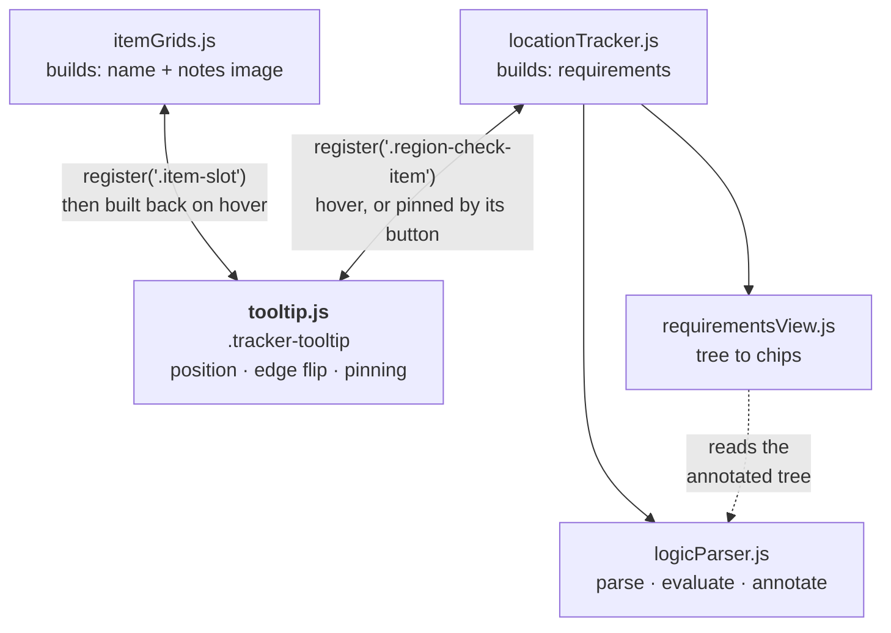

# Tooltips

Hovering an item names it (ITEM_GRIDS.md, *Tooltip*); hovering a check shows what it
needs, each requirement marked met or not; hovering a map marker names its region and
count. On touch, each check has a button that pins the same panel to the bottom of the
screen.

## One tooltip, many owners

`tooltip.js` owns showing, hiding, following the pointer, flipping at the window's
edge, and pinning. It knows nothing about items or logic. An owner registers a selector
and a builder:

```js
window.TrackerData.onReady(() => {
    window.Tooltip.register(".item-slot", (element, { pinned }) => nodeOrNull);
});
```

The builder is called with the hovered element and returns what to show, or `null` for
nothing, so `itemGrids.js` keeps the item knowledge and `locationTracker.js` the logic.
Register inside `onReady`, so the owner doesn't depend on `tooltip.js` loading first
(ARCHITECTURE.md, *Contracts and couplings*).



**Binding is delegated from `document`**, because a region is moved into the map
overlay and back (LAYOUT.md, *Desktop vs mobile*); delegation survives that with
nothing bound again.

**It replaces the `title` attribute**, on the markers too. A native tooltip can't hold
an image or a live count, and both would show, a second apart and in different places.
The accessible name is on `aria-label`.

**It redraws in place** on `trackerStateUpdated`, `trackerChecksUpdated` and any click
or right-click: a click changes what sits under a still pointer, and a tooltip built
once would describe the state before it. The same redraw closes a tooltip whose target
is no longer drawn, such as a check a view toggle just hid.

## Hover and pinned

On a pointer, hovering shows the tooltip at the cursor; that path is behind
`(hover: hover)`, so touch never reaches it. On touch, each check's own button *pins*
the panel instead. The button is drawn only for touch in the phone layout, under
`(hover: none)`, so a mouse in a narrow window hovers as it would on desktop. Item
slots have no pinned mode.

**A docked panel clears the hover position.** The hover path writes `left` and `top`
on the tooltip element, which beats the `.docked` class's edges, so docking empties
them; left behind, they stretch the panel from the pointer's last spot to the bottom of
the screen.

`Tooltip.pin()`, `unpin()` and `togglePin()` reuse the builder already registered for
the element. The panel docks to the bottom of the screen rather than anchoring to the
row, so it lands in the same place every time and never needs scrolling to read; since
it is nowhere near the row, it leads with the check's name.

The button only shows the panel, never ticks its check, and says whether the panel is
up with `aria-expanded`. A second tap on it puts the panel away; another check's button
moves the panel to that check in one tap. A tap on the panel itself leaves it up.

**Anything that activates a control closes it, and the control still does its job.**
Tapping a check completes it and closes the panel; tapping a region header opens it and
closes the panel. It listens for `click` rather than `pointerdown`: a keyboard
activates with a click and no pointer event, and a finger that starts a scroll fires
`pointerdown` but no click. Escape closes it too, and dismisses a hover tooltip.

**It closes on crossing to desktop**, where its button is hidden and it would have no
way to close. It asks whether the button is still drawn rather than knowing the
breakpoint, so this file never learns the number.

## Things that bite

- **The tooltip must never be under its own pointer**: `pointer-events: none`. Without
  it, a tooltip appearing under the cursor fires `mouseout` on the target, which hides
  the tooltip, which uncovers the target, forever.
- **Content that grows after it shows has to be placed again.** An image has no height
  until it loads, so the item builder calls `Tooltip.reposition()` on its `load`.
- **The hover tooltip is `width: max-content`.** Shrink-to-fit takes its width from the
  room between its current position and the window's edge, so it would change size as
  the pointer moved. The pinned panel sets its width back to `auto`.
- **A builder that throws closes the tooltip** and is named once in the console, rather
  than leaving a docked, empty panel with nothing to close it.
- **The pinned panel is fixed**, so scrolling doesn't strand it, and it isn't closed on
  scroll.
- **Clearing the home bar depends on `viewport-fit=cover`.** The panel adds the
  safe-area insets to its offsets, and on an iPhone those are only non-zero because each
  page asks for `viewport-fit=cover`.

## The requirements list

`requirementsView.js` draws the annotated tree (LOGIC_AND_REGIONS.md, *Logic strings*)
as chips: one per thing you need, wrapping to the panel's width, each led by a ✓ or a ✗
so the state never rests on color alone. A chip is blue when met, red when it is what's
missing, and gray when another route already covers it. Nested `&` is flattened, so a
region's entry and the check's own logic give separate chips. The heading counts what's
missing (`3 missing`, or `all met`), from the list's `data-missing`. The same chips are
drawn on hover and in the pinned panel. They keep the logic's order, so they don't move
around as items are collected.

**Alternatives stay in one chip** (`A or B`), except an either/or whose alternatives
have parts of their own, which would need nested parentheses to read. That becomes a
dashed *Any one of* group, one route per line, each with its own mark: ✓ when you can
do it, red ✗ while nothing else meets the requirement, gray ✗ once another route does.
A plain either/or of four or more items is listed the same way. A requirement whose
routes would multiply past six, beyond what was written, stays on one line.

**Requirements stop repeating each other.** Before drawing, `simplify()` in
`requirementsView.js` rewrites the requirement as the fewest chips that mean exactly the
same thing, so no mark can change, and the check's color never goes through it. Its
steps repeat until nothing changes:

- **What one requirement asks for outright is given to the rest.** Of two counts of one
  item the higher stays (`key>=3` covers `key>=2` and the bare item), an either/or
  offering something given is already met and drops out, and a way in that includes it
  loses that part. A count against a setting is weighed at the setting's number.
- **A requirement the others already cover drops out**: a room's either/or that a check
  inside it narrows (an implied layer, LOGIC_AND_REGIONS.md).
- **Inside an either/or**, a way in that asks for everything another does and more drops
  out, and an item every way in asks for becomes its own chip.

An item can still appear twice when it is part of two separate choices, neither of
which covers the other: both choices are real. `tests/node/requirementsView.test.js`
holds each step to examples worked out by hand, and checks that what is listed means
exactly the requirement for every check in the test world; the game suite does the
same for every check in the game.

**A flag earned in the check's own region stands in for the way in.** When a check, or a
group above it, asks outright for a location flag earned in the same region, the layers
it shares with the flag's check are left out: the region's entry, and every group that
holds both. The flag's chain already holds those exact strings, so leaving them out
changes no mark, only how long the list is. In Majora's Mask, Oath to Order after
each temple's boss shows only that boss's flag, not the whole temple entry again. A
flag earned in another region leaves every layer listed, and the sweep always
evaluates them all (`tooltipLogic()` in `locationTracker.js`).

**Names** come from `Items.json`, then the flags' and helpers' own `name`, then the
token definitions, and last the raw id, so a typo shows rather than a blank chip. A
`>=` reads as a count, `Tokens 12/30`; against a setting the target is its current
number, or `?` when it has none.

**A non-randomized check says what it holds**, in a `Vanilla: <item>` line above the
requirements: the item's name for an `Items.json` id, otherwise the text as written.
It is text only, since item images are too small to read at tooltip size and most
vanilla contents have none. A randomized check has no such line.
